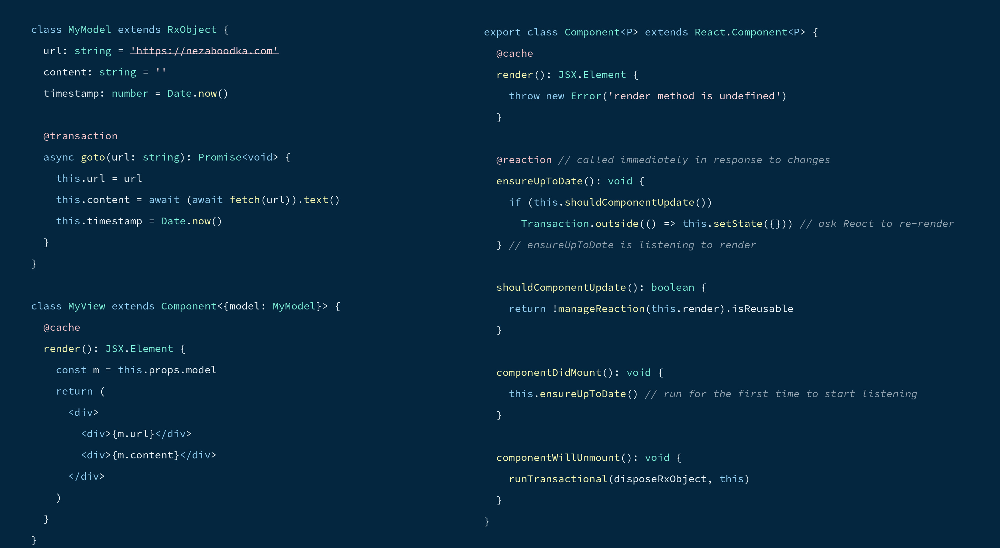


[](https://en.wikipedia.org/wiki/Software_release_life_cycle#Release_candidate)
[](https://github.com/nezaboodka/reactronic/blob/master/LICENSE)
[](https://www.npmjs.com/package/reactronic)
[](https://bundlephobia.com/result?p=reactronic)


[](https://gitlab.com/nezaboodka/nevod.website/-/blob/master/README.md)

# **Reactronic** - Transactional Reactive State Management

Reactronic is an experimental JavaScript library that provides
[transactional reactive](https://blog.nezaboodka.com/post/2019/593-modern-database-should-natively-support-transactionally-reactive-programming)
state management in a Web application.

Transactional reactivity means that state changes are
being made in an isolated data snapshot and then, once
atomically applied, are **consistently propagated** to
corresponding visual components for (re)rendering. All
that is done in automatic, seamless, and fine-grained
way. Reactronic **takes full care of tracking dependencies**
between visual components (reactions and caches) and
application state (reactive objects and their signals).

Transactional reactivity is based on four fundamental
concepts:

  - **Reactive Object** (`RxObject`) - an object that stores
    data of an application (state). Its fields are signals
    and cause reactions upon their changes;
  - **Transaction** (`@transaction`) - a function that makes
    changes in signals in an atomic way ("all or nothing");
  - **Reaction** (`@reaction`) - a function that is
    (re-)executed in response to changes made in
    signals by transactions;
  - **Cache** (`@cache`) - a function whose result is
    remembered and, once obsolete, is re-executed on demand.

The following picture illustrates relationships between
the concepts in the source code:



Demo application built with Reactronic: https://nevod.io/#/playground.
Source code of the demo: https://gitlab.com/nezaboodka/nevod.web.public/-/blob/master/README.md.

Quick introduction and detailed description is below.

## Quick Introduction

Here is an example of transactional reactive code:

``` typescript
class Demo extends RxObject {
  name: string = 'Nezaboodka Software'
  email: string = 'contact@nezaboodka.com'

  @transaction
  saveContact(name: string, email: string): void {
    this.name = name
    this.email = email
  }

  @reaction
  printContact(): void {
    // depends on `name` and `email` and reacts to their changes
    if (this.email.indexOf('@') >= 0)
      throw new Error(`wrong email ${this.email}`)
    console.log(this.name + ' <' + this.email + '>')
  }
}
```

In the example above, `Demo` is a reactive object,
meaning that access to its signals is seamlessly tracked
to determine dependent reactions and caches.
Reaction `printContact` reads `name` and `email`
signals, thus depends on them. It is executed automatically
in response to changes of these signals made by the
transaction `saveContact`.

Here is an example of a cached result that is
(re-)computed on-demand:

``` typescript
class Demo extends RxObject {
  name: string = 'Nezaboodka Software'
  email: string = 'contact@nezaboodka.com'

  @cache
  get contact(): string {
    return this.name + ' <' + this.email + '>'
  }

  @reaction
  printContact(): void {
    if (this.contact !== '')
      console.log(this.contact)
  }
}
```

In the example above, the result of the `contact` cache is
computed from signals `name` and `email`. Once
computed, the result is remembered and is reused until
signals `name` and `email` are changed. Once
those signals change, the `contact` result becomes obsolete,
thus causing execution of the dependent reaction
`printContact`. When reaction `printContact` runs,
it reads `contact` and causes its re-computation.

## Reactive Objects

Reactive objects store data of an application.
An `RxObject` tracks access to its signals, both on reads
and writes. `@signal(false)` excludes a field from tracking.
A transactional object (`TxObject`) tracks a field only when
that field is marked with `@signal`.

``` typescript
class MyModel extends RxObject {
  url: string = "https://github.com/nezaboodka/reactronic"
  content: string = "transactional reactive state management"
  timestamp: Date = Date.now()
}
```

In the example above, the class `MyModel` is based on
Reactronic's `RxObject` class and its
signals `url`, `content`, and `timestamp` are tracked.

## Transaction

A transaction makes changes in signals in an atomic way
("all or nothing"), thus provoking execution of dependent
reactions and renewal of dependent caches.
A transaction is instrumented with hooks to
provide transparent atomicity (by implicit context
switching and isolation).

``` typescript
class MyModel extends RxObject {
  // ...
  @transaction
  async load(url: string): Promise<void> {
    this.url = url
    this.content = await fetch(url)
    this.timestamp = Date.now()
  }
}
```

In the example above, the transaction `load` makes
changes to signals `url`, `content` and `timestamp`.
While the transaction is running, the changes are visible
only inside the transaction itself. The new values become
atomically visible outside of the transaction only upon its
completion.

Atomicity is achieved by making changes in an isolated
data snapshot that is not visible outside of the running
transaction until it is fully finished and applied. Multiple
objects and their signals can be changed with full
respect to the all-or-nothing principle. To do so,
a separate data snapshot is automatically maintained for
each transaction. That is a logical snapshot
that does not create a full copy of all the data.

Compensating rollback operations are not needed in case
of a transaction failure, because all the changes
made by the transaction in its logical snapshot are
simply discarded. Once a transaction is
successfully applied, affected cache results are marked
as obsolete and corresponding caches are
re-executed in a proper order (but only when all the
data changes are fully applied).

Asynchronous operations (promises) are supported out of
the box during transaction execution.
A transaction may consist of a set of asynchronous
calls prolonging it until completion of all of
them. An asynchronous call may spawn other asynchronous
calls, which prolong the transaction until the whole
chain of asynchronous operations is fully completed.

## Reactions & Caches

A reaction is automatically and immediately called
in response to changes in signals made by
transactions. A cache is called on demand
to renew the result if it was marked as obsolete due to
changes made by a transaction. Reactions and caches
are instrumented with hooks for seamless
listening to those signals and other caches
(dependencies) which are used during their
execution.

``` tsx
class MyView extends Component<{model: MyModel}> {
  @cache
  render(): React.JSX.Element {
    return (
      <div>
        <h1>{this.props.model.url}</h1>
        <div>{this.props.model.content}</div>
      </div>
    )
  } // render is listening to "url" and "content"
}
```

``` tsx
class Component<P> extends React.Component<P> {
  @cache
  render(): React.JSX.Element {
    throw new Error('render method is undefined')
  }

  @reaction // called in response to changes
  ensureUpToDate(): void {
    if (this.shouldComponentUpdate()) {
      // Ask React to re-render
      Transaction.outside(() => this.setState({}))
    }
  } // ensureUpToDate is listening to render

  shouldComponentUpdate(): boolean {
    const r = manageReaction(this.render)
    return !r.isReusable
  }

  componentDidMount(): void {
    // Run for the first time to start listening
    this.ensureUpToDate()
  }

  componentWillUnmount(): void {
    runTransactional(disposeRxObject, this)
  }
}
```

In the example above, reaction `ensureUpToDate`
transparently listens to the cache `render`.
In turn, cache `render` listens to the
signals `url` and `content` of a corresponding `MyModel`
object. Once `url` or `content` values are changed, the
cache `render` becomes obsolete and causes the
reaction `ensureUpToDate` to become obsolete and
re-execute. While being executed, the reaction
`ensureUpToDate` enqueues a re-rendering request to React, which
calls cache `render`, causing it to renew its
cached value.

In the general case, all reactions and caches
are automatically and immediately marked as obsolete
when changes are made in those signals and
other cache results that were used during their
execution. Once marked, they are
executed again, either immediately (for
reactions) or on demand (for caches).

Reactronic takes full care of tracking dependencies
between signals and reactions/caches.
With Reactronic, you no longer need to create
data change events in one set of objects, listen to
these events in other objects, and manually maintain
switching from the previous object version to a new one.

## Behavior Options

There are multiple options to configure behavior of
transactional reactivity.

**Order** option defines the execution order of reactions.
Reactions with a smaller `order` run first. The default is `0`.

**Throttling** option defines how often a reaction
is executed in case of recurring changes:

  - `(ms)` - minimal delay in milliseconds between executions;
  - `-1` - execute immediately once transaction changes are applied (synchronously);
  - `0` - execute immediately via event loop (asynchronously with zero timeout);
  - `>= Number.MAX_SAFE_INTEGER` - never execute (suspended reaction).

**Reentrance** option defines how to handle reentrant calls of transactions
and reactions:

  - `preventWithError` - fail with error if there is an existing call in progress;
  - `waitAndRestart` - wait for the existing call to finish and then restart the reentrant one;
  - `cancelPrevious` - cancel the previous call in favor of the recent one;
  - `cancelAndWaitPrevious` - cancel the previous call in favor of the recent one (but wait until canceling is completed);
  - `overwritePrevious` - allow the previous call to complete, but overwrite it, ignoring any conflicts;
  - `runSideBySide` - multiple simultaneous operations are allowed.

**Indicator** is an object that maintains status of running operations
it is attached to. A single indicator can be shared between
multiple transactions, reactions, and caches, thus maintaining
a consolidated status for all of them (busy, workers, etc).

## Notes

Inspired by: MobX, Nezaboodka, Excel.

Key Reactronic principles and differentiators:

  - No compromises on consistency, clarity, and simplicity;
  - Minimalism and zero boilerplating (it's not a framework bloating your code);
  - Async, patches, undo/redo, conflict resolving are provided out of the box;
  - Seamless integration with transactional reactive object-oriented databases like [Nezaboodka](https://nezaboodka.com/#products);
  - Compact dependency-free implementation consisting of less than 2K lines of code.

Roadmap:

  - Patches and conflict resolution API (partially done)
  - History/undo/redo API and implementation (partially done)
  - Sync API and implementation (not implemented yet)

## Installation

NPM: `npm install reactronic`

## API (TypeScript)

```typescript

// Classes

class TxObject { } // transactional object
class RxObject { } // reactive object

// Decorators & Operators

function signal(boolean) // field only
function signal(proto, prop) // field only
function transaction(proto, prop, pd) // method only
function reaction(proto, prop, pd) // method only
function cache(proto, prop, pd) // method only
function options(value: Partial<ReactivityOptions>): F<any>

function runTransactional<T>(func: F<T>, ...args: any[]): T
function runTransactional<T>(options: SnapshotOptions, func: F<T>, ...args: any[]): T
function runNonReactive<T>(func: F<T>, ...args: any[]): T
function runSensitive<T>(sensitivity: boolean, func: F<T>, ...args: any[]): T
function manageReaction<T>(method: F<T>): Reaction<T>
function configureCurrentReaction(options: Partial<ReactivityOptions>): ReactivityOptions
function disposeRxObject(obj: any): void

// SnapshotOptions, ReactivityOptions, Kind, Isolation, Reentrance, Indicator, LoggingOptions, ProfilingOptions

export type SnapshotOptions = {
  readonly hint?: string
  readonly isolation?: Isolation
  readonly journal?: Journal
  readonly logging?: Partial<LoggingOptions>
  readonly token?: any
}

type ReactivityOptions = {
  readonly kind: Kind
  readonly isolation: Isolation
  readonly order: number
  readonly noSideEffects: boolean
  readonly signalArgs: boolean
  readonly throttling: number // milliseconds, -1 is immediately, Number.MAX_SAFE_INTEGER is never
  readonly reentrance: Reentrance
  readonly allowObsoleteToFinish: boolean
  readonly journal: Journal | undefined
  readonly indicator: Indicator | null
  readonly logging?: Partial<LoggingOptions>
}

enum Kind {
  plain = 0,
  transaction = 1,
  reaction = 2,
  cache = 3
}

enum Isolation {
  joinToCurrentTransaction = 0,
  joinAsNestedTransaction = 1,
  disjoinFromOuterTransaction = 2,
  disjoinFromOuterAndInnerTransactions = 3,
  disjoinForInternalDisposal = 4,
}

enum Reentrance {
  preventWithError = 1, // fail with error if there is an existing call in progress (default)
  waitAndRestart = 0, // wait for existing call to finish and then restart reentrant one
  cancelPrevious = -1, // cancel previous call in favor of recent one
  cancelAndWaitPrevious = -2, // cancel previous call in favor of recent one (but wait until canceling is completed)
  overwritePrevious = -3, // allow previous to complete, but overwrite it with ignoring any conflicts
  runSideBySide = -4 // multiple simultaneous operations are allowed
}

class Indicator {
  readonly isBusy: boolean
  readonly counter: number
  readonly workers: ReadonlySet<Worker>
  readonly busyDuration: number
  abstract whenBusy(): Promise<void>
  abstract whenIdle(): Promise<void>
  static create(hint: string, activationDelay: number, deactivationDelay: number, durationResolution: number): Indicator
}

type Worker = {
  readonly id: number
  readonly name: string
  readonly isCanceled: boolean
  readonly isFinished: boolean
  cancel(error: Error, restartAfter?: Worker | null): void
  whenFinished(): Promise<void>
}

type LoggingOptions = {
  readonly enabled: boolean
  readonly transaction: boolean
  readonly operation: boolean
  readonly step: boolean
  readonly indicator: boolean
  readonly read: boolean
  readonly write: boolean
  readonly change: boolean
  readonly obsolete: boolean
  readonly error: boolean
  readonly warning: boolean
  readonly gc: boolean
  readonly color: number
  readonly prefix: string
  readonly margin1: number
  readonly margin2: number
}

type ProfilingOptions = {
  repetitiveUsageWarningThreshold: number // default: 10 times
  mainThreadBlockingWarningThreshold: number // default: 16.6 ms
  asyncActionDurationWarningThreshold: number // default: 150 ms
  garbageCollectionSummaryInterval: number // default: 3000 ms
}

// Transaction

type F<T> = (...args: any[]) => T

class Transaction implements Worker {
  static readonly current: Transaction

  readonly id: number
  readonly name: string
  readonly caption: string
  readonly options: SnapshotOptions
  readonly timestamp: number
  readonly error: Error | undefined
  readonly parent?: Transaction

  run<T>(func: F<T>, ...args: any[]): T
  inspect<T>(func: F<T>, ...args: any[]): T
  apply(): void
  seal(): this // a1.seal().whenFinished().then(fulfill, reject)
  wrapAsPending<T>(func: F<T>, secondary: boolean): F<T>
  cancel(error: Error, retryAfterOrIgnore?: Worker | null): this
  readonly isCanceled: boolean
  readonly isFinished: boolean
  whenFinished(includingParent?: boolean): Promise<void>

  static create(options: SnapshotOptions | null, parent?: Transaction): Transaction
  static run<T>(options: SnapshotOptions | null, func: F<T>, ...args: any[]): T
  static isolate<T>(func: F<T>, ...args: any[]): T
  static outside<T>(func: F<T>, ...args: any[]): T

  static isFrameOver(everyN?: number, timeLimit?: number): boolean
  static requestNextFrame(sleepTime?: number): Promise<void>
  static readonly isCanceled: boolean
}

// Reaction

type Reaction<T> = {
  readonly options: ReactivityOptions
  readonly args: ReadonlyArray<any>
  readonly result: T
  readonly error: any
  readonly stamp: number
  readonly isReusable: boolean

  configure(options: Partial<ReactivityOptions>): ReactivityOptions
  markObsolete(): void
  pullLastResult(args?: any[]): any
}

// ReactiveSystem

class ReactiveSystem {
  static why(brief: boolean = false): string
  static getRevisionOf(obj: any): number
  static takeSnapshot<T>(obj: T): T
  static reactivityAutoStartDisabled: boolean
  static readonly isLogging: boolean
  static readonly loggingOptions: LoggingOptions
  static setLoggingMode(isOn: boolean, options?: LoggingOptions): void
  static setLoggingHint<T extends object>(obj: T, name: string | undefined): void
  static getLoggingHint<T extends object>(obj: T, full?: boolean): string | undefined
  static setProfilingMode(isOn: boolean, options?: Partial<ProfilingOptions>): void
}

```

## Contribution

By contributing, you agree that your contributions will be
automatically licensed under the Apache 2.0 license (see LICENSE file).
